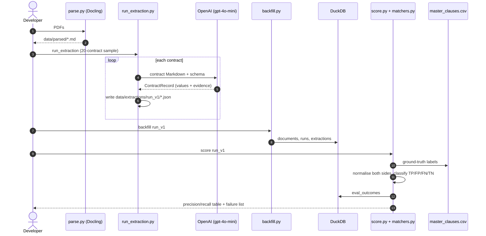
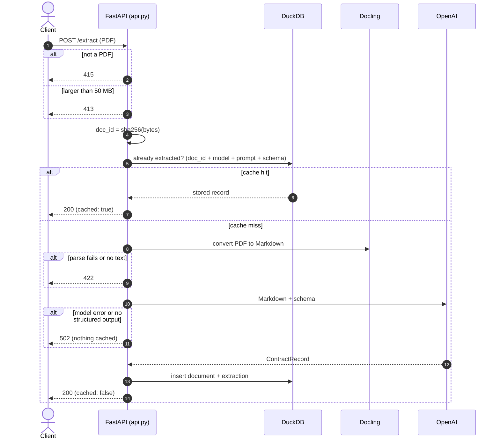

# doc-intel

Structured extraction from legal contracts, with a measurable accuracy score.

PDF → Markdown ([Docling](https://github.com/docling-project/docling)) → typed record (OpenAI structured output) → DuckDB → evaluation against the [CUAD](https://www.atticusprojectai.org/cuad) expert labels.

## Objective

Turn unstructured contracts into queryable data (governing law, parties, dates, key clauses) **and prove how good the extraction is**.

Anyone can get an LLM to return JSON. The harder question is whether the JSON is right. This project is built around that question:

- **Typed output:** every field is defined in a Pydantic schema, and each value carries a verbatim evidence quote so a reviewer can check it against the contract.
- **Ground truth:** results are scored against 510 expert-labelled CUAD contracts, per field, as precision and recall.
- **Reproducible runs:** each run is stored with its model, prompt hash and schema version, so "did prompt v2 beat v1?" is a SQL query, not a guess.
- **Cheap to change:** the extraction is exposed as an API with caching, and the eval harness runs offline against saved outputs.

## Extracted fields

Defined in [schema.py](src/doc_intel/schema.py). Each has a matching `*_evidence` field.

| Field | Type | Meaning |
|---|---|---|
| `governing_law` | text | Jurisdiction, as a bare place name (e.g. `Delaware`) |
| `parties` | list | Contracting entities named in the preamble |
| `agreement_date` | ISO date | Date the contract was entered into |
| `renewal_term` | free text | Renewal / extension provisions |
| `cap_on_liability` | bool | Explicit monetary cap on liability |
| `non_compete` | bool | Non-compete clause present |

## Architecture

```
data/raw (CUAD PDFs + master_clauses.csv)
        │
        ▼  parse.py (Docling)
data/parsed/*.md
        │
        ▼  extract.py (OpenAI structured output → ContractRecord)
data/extractions/<run>/*.json   or   DuckDB `extractions` (via the API)
        │
        ▼  backfill.py
DuckDB: documents · runs · extractions · eval_outcomes · contract_records (view)
        │
        ▼  score.py + matchers.py   (vs master_clauses.csv)
precision / recall per field + failure list
```

DuckDB tables, from [store.py](src/doc_intel/store.py):

| Table | Purpose |
|---|---|
| `documents` | One row per PDF, keyed by the SHA-256 of its bytes |
| `runs` | One row per (model, prompt hash, schema version) |
| `extractions` | Append-only: the full record as JSON, plus tokens and latency |
| `eval_outcomes` | One TP / FP / FN / TN row per field per document per run |
| `contract_records` | View that types the JSON into columns for SQL analytics |

## Sequence diagrams

### Evaluation flow (batch)



### API flow (`POST /extract`)



## How scoring works

Each field is compared to the CUAD label in three steps ([matchers.py](src/doc_intel/matchers.py)):

1. **Normalise** both sides to the same shape. Examples: `State of Delaware` and `Delaware` match, `England and Wales` becomes `{england, wales}`, and party aliases like `(“Chase”)` are dropped.
2. **Decide absence** with one rule for every field type (`None`, `False`, empty, `NaN`).
3. **Classify** as TP / FP / FN / TN. A wrong value counts as both an FP and an FN.

Notes:
- `parties` is scored per party, so its counts don't sum to the number of contracts.
- `score.py` asserts that outcomes cover every scored contract, and lists skipped files rather than hiding them.
- Partial dates such as `03/[]/1999` never match an invented full date.

## Setup

Requires Python 3.12 and [uv](https://docs.astral.sh/uv/).

```bash
uv sync
echo "OPENAI_API_KEY=sk-..." > .env   # .env is git-ignored
```

Download CUAD and place it under `data/raw/` (`master_clauses.csv`, `full_contract_pdf/`, `full_contract_txt/`). `data/raw/` is git-ignored because of its size.

## Usage

Run everything from the project root.

| Step | Command | Output |
|---|---|---|
| Parse a PDF | `uv run python -m doc_intel.parse <file.pdf>` | `data/parsed/<name>.md` |
| Draw the 20-contract sample | `uv run python -m doc_intel.helper` | `evals/sample_v1.txt` |
| Extract the sample | `uv run python -m doc_intel.run_extraction` | `data/extractions/run_v1/*.json` |
| Load run into DuckDB | `uv run python -m doc_intel.backfill [run]` | `data/doc_intel.duckdb` |
| Score against CUAD | `uv run python -m doc_intel.score [run]` | precision/recall table + failure list |
| Analytics queries | `uv run python -m doc_intel.queries` | |
| Tests (offline, no API cost) | `uv run pytest evals` | 31 tests |

`parsed/` must contain the sampled contracts before extraction.

### API

```bash
unset VIRTUAL_ENV   # avoids uv's mismatched-environment warning
uv run uvicorn doc_intel.api:app --reload
```

Open http://127.0.0.1:8000/docs to try it by hand: `POST /extract` → Try it out → choose a PDF. The first upload calls OpenAI; uploading the same file again returns `cached: true`.

| Endpoint | Description |
|---|---|
| `GET /health` | Liveness check |
| `POST /extract` | Multipart PDF (max 50 MB). Returns `doc_id`, `run_id`, `cached` and the `ContractRecord`. Results are cached in DuckDB by PDF hash + model + prompt + schema. |

| Status | Cause |
|---|---|
| 413 | File over 50 MB |
| 415 | Not a PDF |
| 422 | PDF can't be parsed, or has no text |
| 502 | Model error or no structured output (not cached, so a retry works) |

## Tests

`uv run pytest evals` runs offline. `test_api.py` uses FastAPI's `TestClient` with `extract`, Docling and the DuckDB file mocked. It covers a successful extraction, a repeated upload (`cached: true`, model called once), a non-PDF (415), an oversized file (413), parse failures (422) and model failures (502, not cached). `test_matchers.py` covers the normalisers and classification using values seen in run_v1.

## Layout

```
src/doc_intel/
  schema.py          ContractRecord (pydantic)
  extract.py         prompt, MODEL, OpenAI call
  parse.py           Docling PDF → Markdown
  run_extraction.py  batch extraction of the sample
  store.py           DuckDB schema + append-only inserts
  backfill.py        load a run directory into DuckDB
  matchers.py        normalisers + TP/FP/FN/TN classification
  score.py           eval harness
  queries.py         SQL analytics
  api.py             FastAPI service
evals/               test_matchers.py, test_api.py, sample list, saved results
exploration.ipynb    CUAD label exploration
```

## Results (run_v1, gpt-4o-mini, 20 contracts)

| Field | Precision | Recall |
|---|---|---|
| agreement_date | 0.90 | 0.95 |
| governing_law | 0.95 | 0.95 |
| cap_on_liability | 1.00 | 0.22 |
| non_compete | 0.80 | 0.33 |
| parties (per party) | 0.98 | 0.48 |
| renewal_term | 0.08 | 0.09 |

The sample is small (20 contracts), so treat these as directional. Full per-contract failures are in [evals/results/run_v1.txt](evals/results/run_v1.txt).

## Limitations and next steps

- **Boolean recall is low.** The prompt tells the model to answer `False` unless a clause is explicit, so it misses most liability caps and non-competes. Next: relax the prompt and re-score as `run_v2`.
- **Party coverage is about 0.48.** CUAD labels aliases and roles as separate spans, while the model returns a single name per party.
- **`renewal_term` is free text** matched loosely, which scores poorly. Next: a structured schema (auto-renews, term length, notice period).
- **Long contracts** are sent whole, with no chunking, so very long documents may hit context limits.
- **Single model and parser.** Comparing models is straightforward, because runs are keyed by model, prompt and schema.

## Data note

CUAD includes `ADUROBIOTECH,...CONSULTING AGREEMENT(1)` as a byte-identical copy of the file without `(1)`. Both have ground-truth rows, so both are kept.
